  

<h1 align="center">Sir Faris of the Realm</h1>

<!-- فارس -->

  

  

## 📜 The Chronicle

> ⚔️ *From the depths of the desert citadel of Abu Dhabi — where winds of data shift and machines await a purpose — rode forth a knight sworn to feed the code-hungry and slay the bugs of old. His name, ***Faris*** (فارس), means **Knight** in Arabic. His banner: **Gold &amp; Steel**. His quest: turn raw data into intelligence.*

| 🏰 **Quest Log** | |
|---|---|
| 🏰 **Current Quest** | AI Engineer @ **ILMORA** — forging enterprise AI, agentic systems & intelligent search |
| ⛓️ **Past Fealties** | Data Science Intern @ **Future Optima IT Solutions**, Kochi |
| 🛡️ **Citadel** | **42 Abu Dhabi** — peer-to-peer coding academy; smithing C, algorithms & bare-metal discipline |
| 🎓 **Academy** | B.Tech in **Artificial Intelligence & Data Science** (MESCE) |
| 🌍 **Realm** | 🇦🇪 UAE · open to quests across all known lands |
| 📮 **Raven Mail** | farisabdulsukkur@gmail.com |
| 🐺 **Fellowship** | 1,100+ souls follow his deeds on [LinkedIn](https://www.linkedin.com/in/farisabdulsukkur/) |

  

<table>
  <tr>
    <td width="45%" align="center">
      
    </td>
    <td>

### 🧪 The Knight's Doctrine ⚔️

- 🗡️ **Sword** — Python, the blade for every battle
- 🛡️ **Shield** — C, learned in the crucible of the **42** citadel (libft · printf · get_next_line · push_swap)
- 🐎 **Steed** — YOLO, TensorFlow & PyTorch: computer vision that rides at full gallop
- 📜 **Spellbook** — LLMs, LangChain, LangGraph, RAG, Hugging Face & Deep Learning
- 🧠 **Visions** — OpenCV + OCR: the knight sees what others cannot
- ⚡ **Vows** — Real-world problems · real-time systems · zero mercy for bugs

  </td>
</tr>
</table>

## ⚒️ The Armory

  <b>🗡️ Weapons of Choice (Languages)</b> 
  
  
  
  
    

  <b>🛡️ Enchanted Armor (AI / ML)</b> 
  
  
  
  
  
  
  
  
  
    

  <b>🏋️ Path & Forge (Frameworks)</b> 
  
  
  
  
  
  
  

## 🏇 Quest Board — Featured Crusades

| Quest | Relic | Chronicle |
|---|---|---|
| 🐎 [**The Scrying Steed**](https://github.com/Faris-as/licenseplate-ocr-detection) | `YOLOv8` `EasyOCR` `OpenCV` | Automatic License Plate Recognition — detects plates in video streams, reads the runes, and scribes them to CSV |
| 🚪 [**The Gatekeeper**](https://github.com/Faris-as/Facebased-Attendence-Project) | `OpenCV` `Deep Learning` | Face-based Attendance — the watchman who never sleeps, marking souls in real time |
| 📞 [**Call Me Maybe**](https://github.com/Faris-as/Call_Me_Maybe) | `Python` `LLM` | 42 project — teaching LLMs to answer the call: function calling |
| 🧩 [**The Sorting Gauntlet**](https://github.com/Faris-as/42-push_swap) | `C` `Algorithms` | Sort stacks in the minimum number of moves — a trial of pure strategy |
| 🌀 [**AI Learning Hub**](https://github.com/Faris-as/AI-Learning-Hub) | `ADK` `Python` | Google AI Agents Intensive Capstone — a knight's grimoire for agentic AI |
| 🌩️ [**The Storm Diviner**](https://github.com/Faris-as/weatherai) | `TypeScript` | Weather quests foretold in code |

## 🏆 Badges of Honor

  

## 📈 The Knight's Ledger

  
  

  

  

## 🐉 The Contribution Arena

  <i>The serpent feasts upon the deeds of the Knight 🐍 — <a href="https://github.com/Faris-as/Faris-as/actions/workflows/snake.yml">summoned by GitHub Actions</a></i>

  <picture>
    <source media="(prefers-color-scheme: dark)" srcset="https://raw.githubusercontent.com/Faris-as/Faris-as/output/github-snake-dark.svg"/>
    <source media="(prefers-color-scheme: light)" srcset="https://raw.githubusercontent.com/Faris-as/Faris-as/output/github-snake-light.svg"/>
    
  </picture>

  <picture>
    <source media="(prefers-color-scheme: dark)" srcset="https://raw.githubusercontent.com/Faris-as/Faris-as/main/pacman-contributions.svg"/>
    <source media="(prefers-color-scheme: light)" srcset="https://raw.githubusercontent.com/Faris-as/Faris-as/main/pacman-contributions.svg"/>
    
  </picture>

## 🏰 Send a Raven

  
  
  

<!-- ⚔️ فارس — The Knight lives on. -->
